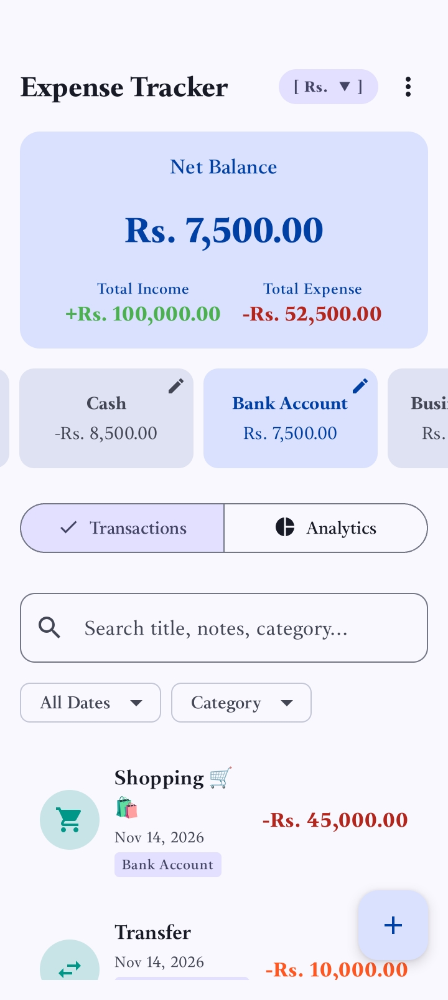
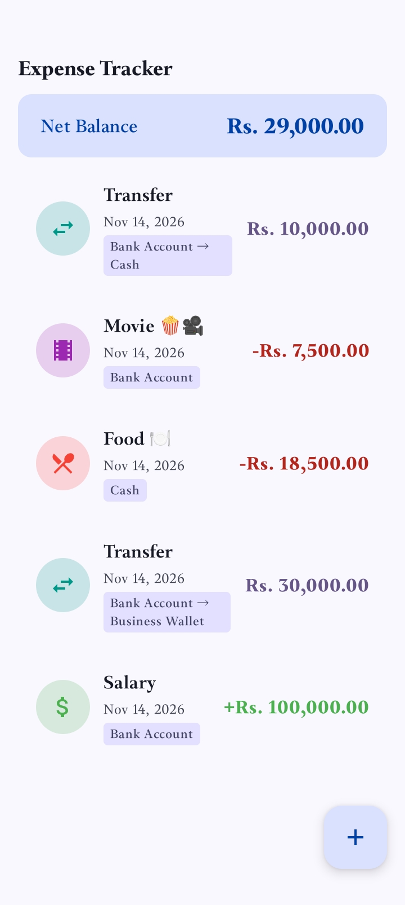
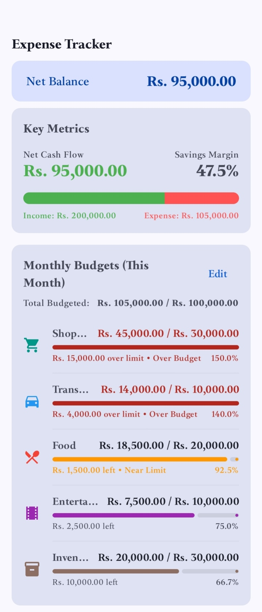
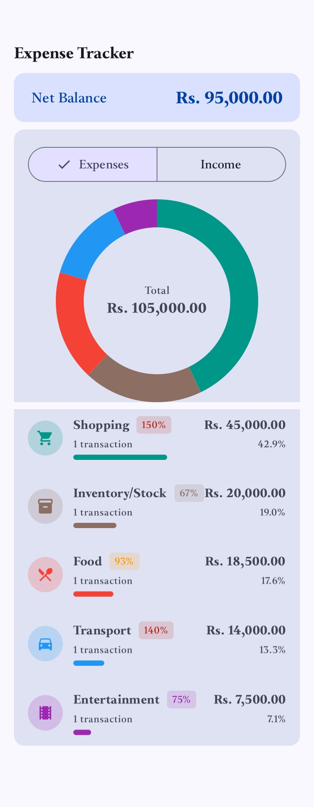
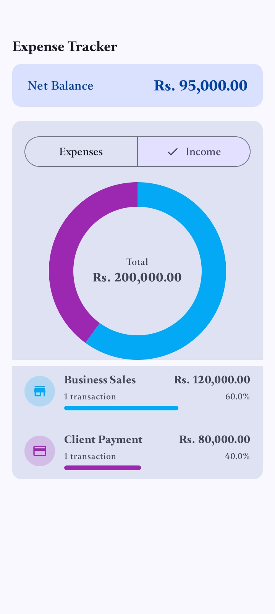
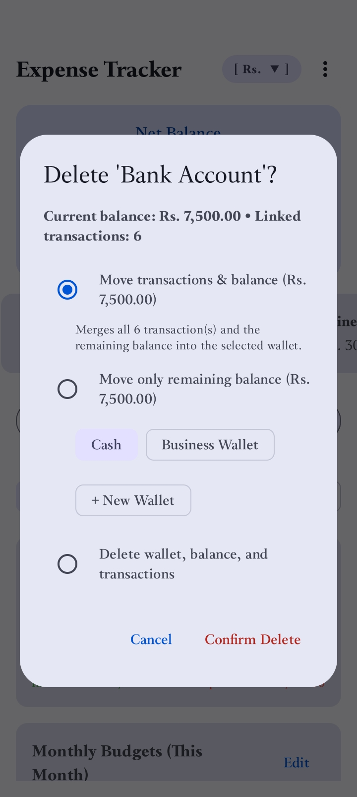

# 💸 Expense Tracker

<div align="center">

[](https://github.com/amuksith/Expense-Tracker/releases)
[](LICENSE)
[](https://developer.android.com)
[](#)
[](https://kotlinlang.org)

  <p>A modern, lightning-fast, <b>100% offline-first</b> personal finance and expense tracker for Android.</p>
</div>

---

## ✨ Core Features & Highlights

- **🔒 100% Offline & Privacy-First:** Zero network permissions, zero telemetry, and no account sign-ups. All financial data stays strictly on your device via Room (SQLite).
- **👛 Multi-Wallet Double-Entry Ledger:** Manage independent accounts (*Cash*, *Bank Account*, *Business Wallet*, *Credit Card*) with real-time balance tracking.
- **🔄 Seamless Internal Transfers:** Move funds between wallets instantly (`Bank Account → Cash`) while automatically excluding internal movements from Income, Expense, and Analytics calculations.
- **🛡️ 3-Mode Safe Wallet Deletion:** Protect your historical data when removing an account:
  - **Mode 1:** Migrate transactions & remaining balance to another wallet.
  - **Mode 2:** Transfer remaining balance only (preserving historical records).
  - **Mode 3:** Complete purge (wallet + all linked history).
- **🎯 Monthly Category Budgets:** Set custom spending caps per category with real-time progress indicators (*Near Limit* & *Over Budget* warnings).
- **🌊 Fluid Material 3 UI:** Powered by spring physics (`animateFloatAsState`) with a collapsible morphing header, smooth scroll transitions, and predictive-back gestures.
- **📊 Interactive Canvas Analytics:** Custom-drawn Jetpack Compose `Canvas` Donut Charts, cash flow bars, Savings Margin KPIs, and ranked category breakdowns.
- **💱 Multi-Currency Switcher:** Toggle instantly between `Rs.`, `$`, `€`, `£`, and `₹` app-wide.
- **⚡ Safe Transaction Management:** Swipe-to-delete rows with a confirmation dialog, one-tap editing, and instant search/date filtering.
- **💾 Secure Local Backups:** Export complete snapshots to `.json` or generate spreadsheet-ready `.csv` reports via Android's Storage Access Framework (SAF).
- **🔍 Transparent FOSS Diagnostics:** Built-in About screen featuring an interactive `AboutLibraries` license viewer, release notes, and automatic local crash logging.

---

## 📸 App Screenshots

| Dashboard & Wallets | Recent Transactions & Transfers | Monthly Category Budgets |
| :---: | :---: | :---: |
|  |  |  |

| Expense Analytics (Canvas Donut) | Income Analytics | 3-Mode Safe Wallet Deletion |
| :---: | :---: | :---: |
|  |  |  |

---

## 🛠️ Tech Stack & Architecture

- **Language:** 100% Kotlin
- **UI Toolkit:** Jetpack Compose & Material 3 (`graphicsLayer`, custom `Canvas`)
- **Navigation:** Jetpack Navigation with Predictive Back gesture support
- **Architecture:** MVVM (`ExpenseViewModel`, `ExpenseRepository`, `StateFlow`)
- **Concurrency:** Kotlin Coroutines & Flow
- **Persistence:** Room Database (SQLite) & `SharedPreferences`
- **File I/O:** Android Storage Access Framework (SAF) + Native `JSONObject`/`JSONArray` serialization

---

## 🚀 Getting Started

### 📦 Install the APK
1. Visit the [**Releases**](../../releases) tab.
2. Download the latest `v1.6.1` `.apk` asset.
3. Install directly on your Android device—no internet or special permissions required.

### 🔨 Build from Source
```bash
git clone [https://github.com/amuksith/ExpenseTracker.git](https://github.com/amuksith/ExpenseTracker.git)
cd ExpenseTracker
./gradlew assembleRelease
```

---

## 💡 Quick Start Guide

1. **Select Currency:** Tap the currency pill (`[ Rs. ▼ ]`) in the top bar to switch currencies instantly.
2. **Create Wallets:** Tap `+ Add Wallet` on the dashboard carousel to initialize your accounts.
3. **Log & Manage:** Tap the **`+`** FAB to record expenses, income, or transfers. Swipe left on any entry to bring up the safety confirmation dialog or tap to edit.
4. **Inspect Analytics:** Switch to the **Analytics** tab to view your Canvas charts and track category budget thresholds.
5. **Backup Data:** Open the top-right overflow menu (`⋮`) to backup your database or export `.csv` spreadsheets.

---

## 📄 License

Distributed under the **GNU Affero General Public License v3.0 (AGPL-3.0)**. See [LICENSE](LICENSE) for more information.